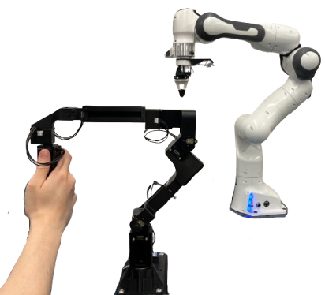

# FACTR 7-DOF gravity compensation

## Franka simulation teleoperation

Use your saved calibration; you do not need to recalibrate every time.
The commands below use `calibration_reference.json`. If you calibrated into
`calibration.json` or another file, substitute that filename in Terminal 2.
Stop any earlier leader/gravity controller before starting.

Terminal 1 starts the Isaac Sim window (the first launch may download Franka assets):

```sh
cd /home/yuchen/projects/factr
bash run_isaac_teleop.sh
```

Wait for `READY: Franka simulation`. Return the leader to its saved reference
pose (each joint must be within approximately 20 degrees) and support it.
Terminal 2 starts **teleop with leader gravity compensation** for 10 minutes:

```sh
cd /home/yuchen/projects/factr
# After reconnecting USB, set latency (use the resolved device if not ttyUSB0):
echo 1 | sudo tee /sys/bus/usb-serial/devices/ttyUSB0/latency_timer
.venv/bin/python factr_teleop.py --calibration calibration_reference.json --gravity-comp --duration 600
```

This loads the saved calibration; it does not recalibrate. Compensation ramps
up over two seconds. Once running, move the leader to control the simulated arm.
Support the leader before pressing Ctrl-C in Terminal 2 or before the 600-second
timer ends, since compensation switches off. Then close the simulation window.

Support and move the physical arm; the simulated Franka follows the seven calibrated
joint angles. This is direct joint mapping, so calibration and motor order/signs
determine the simulated posture. The gripper stays open in this initial version.
The simulator clamps to Franka joint limits and limits target motion to 1.5 rad/s.
It holds the last commanded target when no fresh packet arrives for 250 ms.

The simulated wrist roll (joint 7) has a **+45-degree mapping offset**, applied
to the initial pose and incoming leader angles before joint-limit clamping.
This does not change encoder calibration or the leader gravity URDF. Restart
the simulator to load it. If the correction is in the opposite direction, use:

```sh
bash run_isaac_teleop.sh --wrist-roll-offset-deg -45
```

Use `--wrist-roll-offset-deg 0` to restore the original direct joint mapping.

For an optional read-only test with no leader gravity compensation, use this
instead of the Terminal 2 teleop command and support the full arm weight by hand:

```sh
.venv/bin/python factr_teleop.py --calibration calibration_reference.json
```

Do not run `gravity_comp.py run` at the same time: one process owns the serial bus.
The existing FTDI latency requirement (1 ms), calibration checks, current limits,
and shutdown handling apply to `--gravity-comp`. Support the arm at shutdown.
Closing the simulator does not stop leader compensation; stop Terminal 2 with
Ctrl-C as well. Neither process sends commands to a real Franka.

If startup reports `already torque-enabled`, first stop any running leader
controller with Ctrl-C. If none is running, support/rest the arm and run:

```sh
.venv/bin/python gravity_comp.py stop
```

This disables torque on arm IDs 1–7, clears their watchdog/goal-current registers,
and checks that they report `torque=0`. It leaves the gripper unchanged. Then
return to the reference pose and restart Terminal 2. This recovers leftover
motor state; it does not identify why an earlier process failed to clean up.

`run_isaac_teleop.sh` uses the installed Isaac Sim 6.0 environment
at `/home/yuchen/miniforge3/envs/isaaclab`. Set `ISAAC_PYTHON` to override its Python
path. The launcher supplies the missing `libxml2.so.2` from the existing `tacex50`
environment using a process-local preload; override with `ISAAC_XML_LIBRARY` if
needed. It does not modify either environment or the system GPU driver.
The leader uses this project's `.venv`; UDP on localhost connects the two.
The simulator never opens the motor port, and rendering runs separately from
the gravity loop. No extra packages are needed for the stream.

To test the simulator without any physical robot:

```sh
bash run_isaac_teleop.sh --demo
# Short headless test with tracking statistics:
bash run_isaac_teleop.sh --headless --demo --steps 360 --report /tmp/factr-sim.json
```

Use `--speed`, `--timeout`, or `--udp-port` on the simulator to change its defaults.
If changing the UDP port, pass the same `--udp-port` to `factr_teleop.py`.
The viewer uses Isaac Sim's bundled Franka and articulation controller APIs.

The older installed Isaac Sim 5.0 runtime passed physics tests but crashed in
its RTX renderer with this machine's driver. The launcher therefore uses 6.0;
its windowed Franka demo has been tested successfully.

Validation (2026-09-30): 12 unit tests passed. Isaac Sim 6 completed a 240-step
windowed demo and a 1,800-step headless run with eight seconds of real FACTR
input. The latter switched to holding its target after input stopped and exited
cleanly. Leader torque was never enabled during these tests. The simulation
uses a physics position controller, so tracking can have lag and gravity-induced
position error; it does not teleport the robot to each encoder sample.

## Standalone gravity compensation

Standalone Python, no ROS or follower arm required. Targets the original upright
FACTR Franka leader: IDs 1–7, XC330-T288 except XM430-W210 on joints 2 and 4.
The gripper (ID 8) is inspected but never commanded. Other leader geometries or
servo arrangements require a matching model and conversion constants.

## Setup

```sh
uv venv --python 3.12
uv pip install -r requirements.txt
.venv/bin/python gravity_comp.py inspect
```

The default port is the connected FTDI adapter `FTAKRKBU`, at 4 Mbps.
Override with `--port /dev/serial/by-id/... --baud 4000000` as needed.
USB powers the adapter; the motors also need their external power supply.
`inspect` only pings and reads motor registers. It never enables/disables torque.
If no motors respond, check power and try `--baud 1000000` or `--baud 57600`.
Use Dynamixel Wizard to configure IDs/baud if necessary; this script does not
automatically rewrite bus settings.

## Calibrate, then run

Secure the base upright and manually place the arm in this reference pose:



```sh
.venv/bin/python gravity_comp.py calibrate
.venv/bin/python gravity_comp.py preview
```

Calibration uses the original FACTR method: encoder offsets are snapped to
multiples of 90 degrees, with a 20-degree per-joint reference-pose tolerance.
It assumes the original motor indexing, joint order, and signs.
An arbitrary pose cannot establish absolute joint angles.
Check that preview angles correspond to physical motion before enabling torque.
Calibration is stored in `calibration.json`; recalibrate after mechanical changes.
Encoder whole-turn resets are handled automatically.

For a new calibration file after reassembly, use:

```sh
.venv/bin/python gravity_comp.py calibrate --calibration calibration_gravity_new.json
.venv/bin/python gravity_comp.py preview --calibration calibration_gravity_new.json
.venv/bin/python gravity_comp.py run --calibration calibration_gravity_new.json --duration 30
```

Calibration averages approximately one second of stationary encoder samples.
It does not write motor encoder/homing registers. The continuous-offset mode
and its `--reference-pose` flag have been removed. Existing calibration files
are preserved and remain readable; they are not converted by this code change.
Use the same new `--calibration` path for preview, gravity runs, and teleop if
you want those commands to use your recalibration. Successful calibration
atomically overwrites the selected JSON (default: `calibration.json`). A failed
capture leaves the previous file intact. Passing the indexing check does not independently verify joint
order, direction, or the physical pose.

Set FTDI latency to 1 ms, replacing ttyUSB0 if your port resolves elsewhere:

```sh
readlink -f /dev/serial/by-id/usb-FTDI_USB__-__Serial_Converter_FTAKRKBU-if00-port0
echo 1 | sudo tee /sys/bus/usb-serial/devices/ttyUSB0/latency_timer
```

Return the arm to the reference pose, support its weight, and start:

```sh
.venv/bin/python gravity_comp.py run --duration 30
```

The default is 85% modeled gravity compensation, 0.01 N m s/rad damping, a
two-second ramp, 200 Hz, and a 350 mA cap per joint. These initial limits can
undercompensate the arm. Keep it supported during initial tuning and at shutdown.
Use `--gain`, `--max-current-ma`, and `--duration` to tune after validating the
pose/signs. There is no posture servo, joint-limit repulsion, friction dither,
or follower communication in this initial controller.

`run` switches the arm motors to current mode and leaves that mode configured
after exit. It checks model numbers and motor faults, refuses already-enabled
motors, and sets a 200 ms bus watchdog. Ctrl-C/SIGTERM and failures trigger
best-effort zero current and torque disable on every arm motor. A USB/power
fault can prevent cleanup; the watchdog is not a substitute for accessible
motor power cutoff. Abrupt torque loss lets the arm fall under its own weight.

## Validation

```sh
.venv/bin/python -m unittest discover -s tests -v
```

Tests check dynamics against the potential-energy gradient, encoder wrapping,
current saturation/signs, and cleanup after partial startup/disconnection.
These are software tests, not physical validation of calibration or balance.

Initial read-only inspection (2026-09-20): all IDs 1–8 responded at 4 Mbps;
models matched the expected arrangement, firmware was 53 (XC330) / 50 (XM430),
all hardware error registers were zero, torque was disabled, and bus voltage
was 12.2 V. All five software tests passed. Powered compensation has not yet
been tested; manual reference-pose calibration remains required.

## Train a simulated Franka to pick up a cube

This uses Isaac Lab 2.2 / Isaac Sim 5 headless physics in the existing `tacex50`
environment, and RSL-RL PPO 2.3.3 installed in the project-local `.training_deps`.
It does not connect to the FACTR hardware. The policy observes simulation state
(including cube position), not camera images. Its eight actions control seven
joint position targets and the gripper. Arm gains are Kp 400 / Kd 40, at 50 Hz.
The standard Isaac Lab cube-lift task randomizes the cube's position on the table.

The local training dependencies are already installed. To recreate that overlay:

```bash
uv pip install --python /home/yuchen/miniforge3/envs/tacex50/bin/python \
  --target .training_deps --no-deps -r requirements-training.txt
```

Train (2048 environments, 1500 PPO iterations):

```bash
bash run_cube_policy.sh --output outputs/cube_pick
```

Checkpoints, task/agent configurations, metadata, and TensorBoard logs are saved
in that directory. The final checkpoint is `model_final.pt`; the exported
inference-only TorchScript model is `exported/policy.pt` (36 inputs, 8 outputs).
Joint actions are `default_joint_pos + 0.5 * action[:7]`; negative gripper action
closes the fingers, nonnegative opens them. See `metadata.json` for observation
order and joint defaults. This policy needs cube/target state as well as joints;
it is not yet a controller for the physical leader.

Evaluate on 384 fresh episodes and save one episode for replay:

```bash
bash run_cube_policy.sh --eval --checkpoint outputs/cube_pick/model_final.pt \
  --num-envs 128 --eval-rounds 3 --seed 1000 --record \
  --output outputs/cube_pick_eval
```

`outputs/cube_pick_eval/evaluation.json` reports successes. Success requires the
cube center above 15 cm for half a second, within 8 cm of the end effector, and
moving slower than 0.25 m/s. This is stricter than the training reward.

Watch the recorded evaluation with the working Isaac Sim 6 renderer:

```bash
bash replay_cube_policy.sh
```

This is a replay of recorded simulation states, **not live policy inference**.
It selects a successful episode if one exists, otherwise the highest lift, and
prints the seed, environment index, and success flag. Close the window to stop.
Training/evaluation stays headless because the installed Sim 5 renderer is
incompatible with this machine's current graphics driver.

Resume from a checkpoint for additional iterations in a new output directory:

```bash
bash run_cube_policy.sh --checkpoint outputs/cube_pick/model_final.pt \
  --iterations 500 --output outputs/cube_pick_continued
```

The baseline task and PPO settings come from the installed
[Isaac Lab](https://github.com/isaac-sim/IsaacLab) cube-lift environment.

Completed run: 1500 iterations (73,728,000 transitions), seed 42. The final
checkpoint passed 384/384 evaluation episodes across seeds 1000–1002 with the
criterion above. This result covers the task's configured cube-position range,
not unseen objects, camera observations, or transfer to hardware.

## FACTR inertia-shaping measurements

The staged identification procedure is in
[docs/FACTR_SHAPING_STEPS.md](docs/FACTR_SHAPING_STEPS.md).
The B601-method sensorless hold-and-capture workflow is documented in
[docs/SENSORLESS_GRAVITY_ID.md](docs/SENSORLESS_GRAVITY_ID.md). It requires an
operator and an unloaded catch and does not automatically change calibration.
Run `identify_gravity.py --output outputs/diagnostics/hold_capture_01`:
`c` oscillates all seven joints and returns to DRAG, `d` lets you reposition, `h`
holds, and `r` releases once supported. No manual return to seven target angles.
Capture uses smooth ±0.05 rad motion with 8-second periods and B601’s average
PD-residual estimator. Three seconds settling plus two periods takes 19 seconds.
The capture loop targets 250 Hz (minimum achieved 200 Hz). Optional
`--joint4-max-current-ma 450` allows a J4-only headroom trial; all other joints
stay capped at 350 mA and stored motor limits remain enforced. This is an
experimental setting, not an official FACTR current recommendation.
Fit with `.venv/bin/python identify_gravity.py --output outputs/diagnostics/hold_capture_01 --analyze-only`
(add `--bias` for scale plus offset). Fits remain provisional and are not applied automatically.
Start with `factr_diagnostics.py audit`, then the guided torque-off joint check.
These diagnostics do not change calibration or motor commands and do not yet
identify friction, external force, or physical inertia.

The trial joint-4 gravity reduction was withdrawn after reported sagging.
All gravity-model scales are now 1; `--gain 0.85` restores the earlier
compensation for every joint, including in teleop. Omit `--joint4-gain 0.3`.
Restart a running controller to pick up the change. Encoder calibration and
URDF parameters are unchanged; physical gravity accuracy is still unverified.

## Sources

Model, reference image, motor conversion, and joint conventions come from
[FACTR_Teleop](https://github.com/JasonJZLiu/FACTR_Teleop), revision
`7a07ab3629af03a91c0198df7c44a0082dca77ab` (Jason Jingzhou Liu and Yulong Li,
Apache-2.0; see `models/LICENSE`). The URDF is copied unchanged; visual mesh
files are omitted because only the inertial/kinematic model is loaded.
Register definitions follow the ROBOTIS manuals for
[XC330-T288](https://emanual.robotis.com/docs/en/dxl/x/xc330-t288/) and
[XM430-W210](https://emanual.robotis.com/docs/en/dxl/x/xm430-w210/).

## Inertia shaping: offline observer first

`inertia_shadow.py` replays a `gravity_comp.py --log` CSV without opening the
motor port or sending commands. It uses the previous capped motor command,
model momentum and gravity/Coriolis terms to estimate unexplained effort.
That residual includes friction and gravity/model error; it is not measured
hand force. It never auto-zeroes a stationary residual.

```bash
.venv/bin/python inertia_shadow.py outputs/diagnostics/gravity_sag_01.csv
```

The output folder defaults to `outputs/diagnostics/inertia_shadow_01`;
`shadow.csv` and `report.json` are directly overwritten on each analysis.
A candidate task-inertia reduction factor of 1.25 preserves modeled nullspace
inertia in the seventh DOF. Assistance is gated near geometric singularities
and for two seconds after observer initialization/reset. This proposal is for
offline inspection only: it does not implement an active actuator controller,
power/passivity limits, identified rotor inertia, or a calibrated grip frame.

For a new comparison, keep gravity gains fixed, log quiet supported pauses,
slow J4 motion and gentle starts/stops through the same small range. Mark or
report which periods involved hand support. Do not fit physical inertia from
unknown hand force alone. Hardware assistance remains disabled until observer
behavior and a bounded controller have been evaluated.

Offline sensitivity comparison (does not change motor gains):

```bash
.venv/bin/python inertia_shadow.py outputs/diagnostics/inertia_baseline_01.csv \
  --model-gravity-scale 0.85 --output outputs/diagnostics/inertia_baseline_shadow_g085
```

A nominal full-gravity observer paired with a 0.85 gravity motor command reports
approximately 0.15 times modeled gravity as residual even while stationary.
Changing the assumed gravity scale demonstrates this sensitivity; it does not
prove which model is physically correct or calibrate the arm. Never interpret
the smaller residual by itself as validated hand-force sensing.
